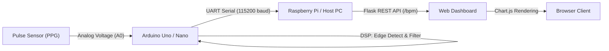

# HminhIOTpulseSENSOR 🫀

A real-time IoT heart rate monitoring system built with a **Photoplethysmography (PPG) Pulse Sensor**, an **Arduino microcontroller**, a **Python Flask backend (Raspberry Pi / PC)**, and an interactive **Chart.js web dashboard**.

---

## 📑 Table of Contents
1. [System Architecture](#-system-architecture)
2. [Project Structure](#-project-structure)
3. [Deep Dive: Analog Waveform to BPM Conversion Algorithm](#-deep-dive-analog-waveform-to-bpm-conversion-algorithm)
   - [1. Principles of Photoplethysmography (PPG)](#1-principles-of-photoplethysmography-ppg)
   - [2. Analog Characteristics & Sampling Rate](#2-analog-characteristics--sampling-rate)
   - [3. Step-by-Step Algorithmic Pipeline](#3-step-by-step-algorithmic-pipeline)
   - [4. Waveform Timing & Trigger Points Diagram](#4-waveform-timing--trigger-points-diagram)
4. [Hardware Wiring Diagram](#-hardware-wiring-diagram)
5. [Installation & Getting Started](#-installation--getting-started)
   - [1. Flash Firmware to Arduino](#1-flash-firmware-to-arduino)
   - [2. Setup Python Server](#2-setup-python-server)
   - [3. Run & Access Dashboard](#3-run--access-dashboard)
6. [Tuning & Best Practices](#-tuning--best-practices)

---

## 🏛 System Architecture



- **Sensing Layer:** Captures microvascular blood volume variations in the capillary bed of a fingertip or earlobe.
- **Embedded Processing Layer (Arduino):** Performs Analog-to-Digital Conversion (ADC), rising-edge threshold detection, physiological window filtering, and 4-sample moving average smoothing.
- **Server Layer (Python Flask):** Reads serial telemetry asynchronously in a background thread and exposes JSON endpoints.
- **Presentation Layer (Frontend):** Renders real-time BPM values and dynamic line graphs updating every second.

---

## 📁 Project Structure

```text
HminhIOTpulseSENSOR/
├── pulse_sensor/
│   └── pulse_sensor.ino   # Arduino firmware: ADC sampling & BPM extraction algorithm
├── app.py                 # Flask server & real-time Chart.js dashboard
├── requirements.txt       # Python dependencies (Flask, pyserial)
├── .gitignore             # Standard git ignore definitions
└── README.md              # Project documentation
```

---

## 🔬 Deep Dive: Analog Waveform to BPM Conversion Algorithm

The firmware (`pulse_sensor.ino`) addresses a fundamental signal processing challenge: **How do we reliably extract an accurate heart rate metric (BPM - Beats Per Minute) from raw, noisy, sinusoidal analog voltage fluctuations emitted by an optical sensor?**

### 1. Principles of Photoplethysmography (PPG)
- The optical pulse sensor integrates a **green LED (~550 nm peak wavelength)** and a matched **photodiode detector**.
- Oxygenated hemoglobin ($HbO_2$) circulating in human arterial blood absorbs green light significantly more efficiently than surrounding tissue.
- **Systolic Phase (Ventricular Contraction):**
  - The left ventricle ejects blood into the arterial system.
  - Blood volume in the fingertip capillary beds surges rapidly.
  - Light absorption peaks, causing the reflected/transmitted light received by the photodiode to drop, producing a rapid voltage surge (the systolic pulse wave peak).
- **Diastolic Phase (Heart Relaxation):**
  - Capillary blood volume recedes.
  - Light absorption decreases, causing the signal voltage to return toward baseline.
- This cyclical cardiovascular phenomenon produces an undulating **PPG pulse wave**.

---

### 2. Analog Characteristics & Sampling Rate
- The Arduino Uno 10-bit Successive Approximation Register (SAR) ADC samples pin `A0` via `analogRead(PulsePin)`.
  - Resolution: $2^{10} = 1024$ quantization levels ($0 \div 1023$, mapping $0\text{V} \div 5\text{V}$).
- The main `loop()` executes with a `delay(5)` throttle:
  $$T_s \approx 5\text{ ms} \implies f_s = \frac{1000}{5} = 200\text{ Hz}$$
- According to the **Nyquist-Shannon Sampling Theorem**, an acquisition rate of $200\text{ Hz}$ comfortably exceeds twice the maximum frequency component of a human pulse waveform ($\approx 3.5\text{ Hz}$, equivalent to 210 BPM), fully preserving the rising flank and timing morphology without aliasing.

---

### 3. Step-by-Step Algorithmic Pipeline

#### Step 1: Rising Edge Detection & Thresholding
```cpp
if (signal > threshold && !aboveThreshold) {
    aboveThreshold = true;
    ...
```
- A baseline detection threshold `threshold = 130` is established.
- When `signal` exceeds `threshold` **while** the state flag `aboveThreshold == false`:
  - A new ventricular pulse wave onset is recognized (**Rising Edge**).
  - The flag `aboveThreshold` is immediately set to `true`. This functions as a debounce mechanism, preventing subsequent ADC readings on the same systolic crest from triggering multiple counts.

#### Step 2: Inter-Beat Interval (IBI) Measurement
```cpp
if (lastBeatTime > 0) {
    beatInterval = now - lastBeatTime;
```
- Using the millisecond timer `millis()`, the duration between the current trigger timestamp `now` and the preceding valid pulse `lastBeatTime` is computed:
  $$\text{IBI} = \text{beatInterval} = \text{now} - \text{lastBeatTime} \quad (\text{ms})$$

#### Step 3: Physiological Window Filtering (Noise Rejection)
```cpp
const int MIN_IBI = 300;   // ms → 200 BPM max
const int MAX_IBI = 1500;  // ms → 40 BPM min

if (beatInterval >= MIN_IBI && beatInterval <= MAX_IBI) {
```
- Normal human heart rates under resting or strenuous physical conditions range between **40 and 200 BPM**:
  - Maximum physiological rate: $\text{BPM}_{\max} = 200 \implies \text{MIN\_IBI} = \frac{60000}{200} = 300\text{ ms}$.
  - Minimum physiological rate: $\text{BPM}_{\min} = 40 \implies \text{MAX\_IBI} = \frac{60000}{40} = 1500\text{ ms}$.
- Any calculated intervals outside this bounds ($< 300\text{ ms}$ or $> 1500\text{ ms}$) are discarded. This rejects high-frequency mechanical vibration, ambient optical flicker, or finger movement artifacts.

#### Step 4: Instantaneous BPM Conversion
```cpp
int bpm = 60000 / beatInterval;
```
- Since there are $60\text{ seconds} \times 1000\text{ ms} = 60,000\text{ ms}$ in one minute:
  $$\text{BPM} = \frac{60000}{\text{IBI (ms)}}$$
- Example: If $\text{beatInterval} = 750\text{ ms} \implies \text{BPM} = \frac{60000}{750} = 80\text{ beats/min}$.

#### Step 5: 4-Sample Moving Average Filter
```cpp
bpmBuffer[bpmIndex++] = bpm;
if (bpmIndex >= 4) {
    bpmIndex = 0;
    bufferFilled = true;
}

if (bufferFilled) {
    int sum = 0;
    for (int i = 0; i < 4; i++) sum += bpmBuffer[i];
    int avgBPM = sum / 4;
```
- Natural **Heart Rate Variability (HRV)** causes subtle beat-to-beat fluctuations. Directly outputting raw instantaneous BPM produces erratic, jumpy readings.
- A circular buffer storing the four most recent valid intervals computes a smoothed moving average:
  $$\text{avgBPM} = \frac{1}{4} \sum_{i=0}^{3} \text{bpmBuffer}[i]$$
- This stabilizes the metric before transmission over UART.

#### Step 6: Hysteresis Reset (Schmitt Trigger Behavior)
```cpp
if (signal < threshold - 5) {
    aboveThreshold = false;
    digitalWrite(LED, LOW);
}
```
- To re-arm the trigger, the waveform must decay strictly below $(\text{threshold} - 5) = 125$.
- A hysteresis margin of $\Delta = 5$ ADC units prevents chattering or rapid toggling caused by noise ripples hovering near the boundary threshold.

---

### 4. Waveform Timing & Trigger Points Diagram

```text
Analog Signal (0 - 1023)
      ^
      |                 Systolic Peak
      |                    /\
      |                   /  \
threshold = 130 ---------[A]---\-------------------------  <-- Trigger pulse (Rising Edge)
      |                 /       \
threshold - 5 = 125 ---/---------[B]---------------------  <-- Arm trigger for next beat (Reset)
      |               /           \        /\
      |              /             \______/  \ (Dicrotic Notch)
      |   __________/                         \__________
      +----------------------------------------------------> Time (t)
                       |<------- beatInterval (IBI) ------>|
```

- **Point [A]:** `signal > threshold` and `aboveThreshold == false` $\rightarrow$ Validates pulse, calculates IBI, updates moving average, blinks pulse LED.
- **Point [B]:** `signal < threshold - 5` $\rightarrow$ Clears flag (`aboveThreshold = false`), turns off LED, and prepares for the subsequent cycle.

---

## 🔌 Hardware Wiring Diagram

| Pulse Sensor Pin | Arduino Pin | Description |
| :--- | :--- | :--- |
| **VCC (+)** | **5V** (or 3.3V) | Sensor power supply |
| **GND (-)** | **GND** | System ground |
| **Signal (S)** | **A0** | Analog pulse waveform input |

- **Pulse LED:** Uses built-in `LED_BUILTIN` (Pin 13 on Arduino Uno/Nano).
- **Host Link:** Connect Arduino via USB cable to Raspberry Pi (`/dev/ttyACM0` or `/dev/ttyUSB0`) or PC (`COM3`, `COM4`, etc.).

---

## 🚀 Installation & Getting Started

### 1. Flash Firmware to Arduino
1. Open the [Arduino IDE](https://www.arduino.cc/en/software).
2. Open [`pulse_sensor/pulse_sensor.ino`](pulse_sensor/pulse_sensor.ino).
3. Select board model (**Tools > Board > Arduino Uno**) and target port (**Tools > Port**).
4. Click **Upload** to flash the microcontroller.

### 2. Setup Python Server
Ensure Python 3.8+ is installed on the host system.

Install dependencies:
```bash
pip install -r requirements.txt
```

### 3. Run & Access Dashboard
Start the Flask application:
```bash
python app.py
```
> **Tip:** You can specify an explicit serial port as an argument:
> ```bash
> python app.py COM3           # Windows
> python app.py /dev/ttyUSB0   # Linux / Raspberry Pi
> ```

Open any modern browser and navigate to:
```text
http://localhost:5000
```
*(Or `http://<YOUR_PI_IP>:5000` from any device connected to the local network).*

---

## 💡 Tuning & Best Practices
1. **Finger Pressure:** Do not press too firmly onto the sensor face. Excessive compression occludes capillary blood flow, flattening the pulsatile amplitude. Use gentle, consistent contact or a Velcro strap.
2. **Threshold Calibration:** If the LED does not pulse synchronously with your heartbeat, open **Tools > Serial Plotter** in Arduino IDE to observe your baseline voltage, and adjust the `threshold` variable in `pulse_sensor.ino` accordingly.
