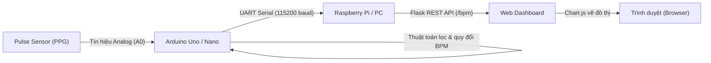

# HminhIOTpulseSENSOR 🫀

Hệ thống giám sát nhịp tim thời gian thực (**Real-time Heart Rate Monitor**) ứng dụng công nghệ cảm biến quang thể tích (**Photoplethysmography - PPG**), vi điều khiển **Arduino**, máy chủ **Raspberry Pi / PC (Python Flask)** và giao diện hiển thị biểu đồ trực quan (**Chart.js**).

---

## 📑 Mục lục
1. [Kiến trúc hệ thống](#-kiến-trúc-hệ-thống)
2. [Cấu trúc thư mục](#-cấu-trúc-thư-mục)
3. [Giải thích chi tiết thuật toán quy đổi sóng Analog ra BPM](#-giải-thích-chi-tiết-thuật-toán-quy-đổi-sóng-analog-ra-bpm)
   - [Nguyên lý cảm biến quang thể tích (PPG)](#1-nguyên-lý-cảm-biến-quang-thể-tích-ppg)
   - [Đặc tính tín hiệu Analog & Tần số lấy mẫu](#2-đặc-tính-tín-hiệu-analog--tần-số-lấy-mẫu)
   - [Các bước xử lý thuật toán](#3-các-bước-xử-lý-thuật-toán)
   - [Trực quan hóa dạng sóng và các mốc kích hoạt](#4-trực-quan-hóa-dạng-sóng-và-các-mốc-kích-hoạt)
4. [Sơ đồ kết nối phần cứng (Wiring)](#-sơ-đồ-kết-nối-phần-cứng-wiring)
5. [Hướng dẫn cài đặt & vận hành](#-hướng-dẫn-cài-đặt--vận-hành)
   - [Nạp chương trình cho Arduino](#1-nạp-chương-trình-cho-arduino)
   - [Cài đặt máy chủ Python Flask](#2-cài-đặt-máy-chủ-python-flask)
   - [Khởi chạy và quan sát](#3-khởi-chạy-và-quan-sát)

---

## 🏛 Kiến trúc hệ thống



- **Tầng cảm biến:** Thu nhận thay đổi thể tích máu dưới mao mạch đầu ngón tay.
- **Tầng xử lý nhúng (Arduino):** Đọc tín hiệu ADC, lọc nhiễu, bắt đỉnh xung sườn lên (Rising Edge), tính khoảng cách IBI và làm mượt trung bình trượt 4 nhịp.
- **Tầng máy chủ (Flask App):** Chạy background thread đọc cổng Serial, cung cấp endpoint `/bpm` và phục vụ giao diện Web Dashboard.
- **Tầng hiển thị (Frontend):** Hiển thị chỉ số BPM lớn và vẽ đồ thị nhịp tim theo thời gian thực (cập nhật 1s/lần với Chart.js).

---

## 📁 Cấu trúc thư mục

```text
HminhIOTpulseSENSOR/
├── pulse_sensor/
│   └── pulse_sensor.ino   # Firmware Arduino: Thuật toán đọc ADC & quy đổi ra BPM
├── app.py                 # Backend Flask + Web Dashboard Chart.js thời gian thực
├── requirements.txt       # Danh sách thư viện Python cần thiết
├── .gitignore             # Quy tắc loại trừ tệp tạm của Git
└── README.md              # Tài liệu hướng dẫn chi tiết dự án
```

---

## 🔬 Giải thích chi tiết thuật toán quy đổi sóng Analog ra BPM

Thuật toán trong `pulse_sensor.ino` giải quyết bài toán: **Làm thế nào để chuyển đổi dòng điện áp dao động liên tục (sóng Analog hình sin mấp mô) từ cảm biến quang thành một con số nhịp tim chuẩn xác (BPM - Beats Per Minute)?**

### 1. Nguyên lý cảm biến quang thể tích (PPG)
- Cảm biến sử dụng một đèn LED màu xanh lá (bước sóng ~550 nm) và một cảm biến quang (Photodiode).
- Huyết sắc tố (**Hemoglobin**) trong máu có đặc tính hấp thụ ánh sáng xanh lá cực kỳ mạnh.
- Mỗi khi tim co bóp tống máu (**tâm thu - Systole**), lượng máu chảy dồn về mao mạch đầu ngón tay tăng vọt $\rightarrow$ ánh sáng bị hấp thụ nhiều hơn $\rightarrow$ lượng ánh sáng phản xạ trở lại Photodiode thay đổi $\rightarrow$ điện áp đầu ra trên chân tín hiệu tăng lên đỉnh.
- Khi tim giãn ra (**tâm trương - Diastole**), thể tích máu giảm $\rightarrow$ điện áp hạ xuống đáy.
- Kết quả tạo thành một **dạng sóng xung huyết động (PPG Pulse Wave)** dạng sóng tuần hoàn.

---

### 2. Đặc tính tín hiệu Analog & Tần số lấy mẫu
- Vi điều khiển Arduino Uno sử dụng bộ chuyển đổi ADC 10-bit:
  - Giá trị đọc được từ chân `A0` qua hàm `analogRead(PulsePin)` nằm trong dải: $0 \div 1023$ (tương ứng với $0\text{V} \div 5\text{V}$).
- Trong vòng lặp `loop()`, lệnh `delay(5)` quy định chu kỳ lấy mẫu:
  $$T_s \approx 5\text{ ms} \implies f_s = \frac{1000}{5} = 200\text{ Hz}$$
- Theo **định lý lấy mẫu Nyquist-Shannon**, tần số lấy mẫu $200\text{ Hz}$ lớn hơn rất nhiều so với tần số nhịp tim cao nhất của con người ($\approx 3.5\text{ Hz}$, tương đương 210 BPM), đảm bảo thu nhận đầy đủ hình thái sóng mà không bị méo tín hiệu.

---

### 3. Các bước xử lý thuật toán

#### Bước 1: Phát hiện sườn lên (Rising Edge Detection)
```cpp
if (signal > threshold && !aboveThreshold) {
    aboveThreshold = true;
    ...
```
- Ngưỡng cố định `threshold = 130` được chọn làm mốc phát hiện xung (điểm vượt ngưỡng).
- Khi giá trị `signal` vượt qua `threshold` **VÀ** cờ `aboveThreshold == false` (tức là trước đó tín hiệu đang ở dưới ngưỡng):
  - Đây chính là **thời điểm bắt đầu của một nhát bóp tim mới (Sườn lên - Rising Edge)**.
  - Ngay lập tức gán `aboveThreshold = true` để **khóa kích hoạt**, tránh việc vòng lặp đọc liên tục ở đỉnh sóng và đếm lặp 1 nhịp nhiều lần.

#### Bước 2: Đo khoảng thời gian giữa hai nhịp liên tiếp (IBI - Inter-Beat Interval)
```cpp
if (lastBeatTime > 0) {
    beatInterval = now - lastBeatTime;
```
- Hàm `millis()` trả về số mili-giây kể từ khi vi điều khiển khởi động.
- Khoảng cách thời gian giữa nhịp đập hiện tại (`now`) và nhịp đập trước đó (`lastBeatTime`) được tính bằng:
  $$\text{IBI} = \text{beatInterval} = \text{now} - \text{lastBeatTime} \quad (\text{đơn vị: ms})$$

#### Bước 3: Bộ lọc dải sinh lý người (Physiological Range Filter)
```cpp
const int MIN_IBI = 300;   // ms → 200 BPM max
const int MAX_IBI = 1500;  // ms → 40 BPM min

if (beatInterval >= MIN_IBI && beatInterval <= MAX_IBI) {
```
- Cơ thể người trong điều kiện bình thường đến vận động mạnh có nhịp tim dao động từ **40 đến 200 BPM**:
  - Với $\text{BPM}_{\max} = 200 \implies \text{MIN\_IBI} = \frac{60000}{200} = 300\text{ ms}$.
  - Với $\text{BPM}_{\min} = 40 \implies \text{MAX\_IBI} = \frac{60000}{40} = 1500\text{ ms}$.
- Bất kỳ khoảng thời gian nào $< 300\text{ ms}$ (thường là nhiễu xung cơ học, rung tay) hoặc $> 1500\text{ ms}$ (tuột cảm biến, mất tiếp xúc) đều bị loại bỏ, giúp hệ thống không đưa ra dữ liệu rác.

#### Bước 4: Công thức quy đổi ra BPM tức thời
```cpp
int bpm = 60000 / beatInterval;
```
- Vì 1 phút có 60 giây = 60.000 ms, nhịp tim tức thời được tính:
  $$\text{BPM} = \frac{60000}{\text{IBI (ms)}}$$
- Ví dụ: Nếu khoảng cách giữa 2 lần đập là $750\text{ ms} \implies \text{BPM} = \frac{60000}{750} = 80\text{ nhịp/phút}$.

#### Bước 5: Bộ lọc trung bình trượt 4 nhịp (Moving Average Filter Buffer)
```cpp
bpmBuffer[bpmIndex++] = bpm;
if (bpmIndex >= 4) {
    bpmIndex = 0;
    bufferFilled = true;
}

if (bufferFilled) {
    int sum = 0;
    for (int i = 0; i < 4; i++) sum += bpmBuffer[i];
    int avgBPM = sum / 4;
```
- Nhịp tim sinh lý của con người có hiện tượng biến thiên tự nhiên giữa từng nhịp (**HRV - Heart Rate Variability**). Nếu hiển thị BPM tức thời, chỉ số sẽ nhảy liên tục gây cảm giác bất ổn định.
- Để làm mượt, thuật toán sử dụng một mảng tròn `bpmBuffer` gồm 4 mẫu gần nhất. Khi bộ đệm đã đầy 4 mẫu (`bufferFilled = true`), giá trị trung bình cộng được tính:
  $$\text{avgBPM} = \frac{1}{4} \sum_{i=0}^{3} \text{bpmBuffer}[i]$$
- Giá trị `avgBPM` này được in ra cổng Serial để truyền sang Raspberry Pi / PC.

#### Bước 6: Cơ chế trễ (Hysteresis - Schmitt Trigger) để xả cờ
```cpp
if (signal < threshold - 5) {
    aboveThreshold = false;
    digitalWrite(LED, LOW);
}
```
- Khi sóng tim đi xuống, ta **không** hạ cờ ngay tại điểm `threshold`, mà phải đợi tín hiệu rơi xuống dưới $\text{threshold} - 5$ (tức là $< 125$).
- **Tại sao cần vùng trễ (Hysteresis)?**
  - Tín hiệu analog luôn có nhiễu sóng nhỏ (ripple noise). Nếu không có độ lệch trễ 5 đơn vị ADC, tín hiệu khi lượn lờ quanh ngưỡng 130 có thể kích hoạt bật/tắt liên tục (chattering), gây ra nhịp tim giả mạo.

---

### 4. Trực quan hóa dạng sóng và các mốc kích hoạt

```text
Điện áp ADC (0 - 1023)
      ^
      |                 Peak (Đỉnh xung tim)
      |                    /\
      |                   /  \
threshold = 130 ---------[A]---\-------------------------  <-- Kích hoạt nhịp (Rising Edge)
      |                 /       \
threshold - 5 = 125 ---/---------[B]---------------------  <-- Hạ cờ chuẩn bị nhịp mới (Reset)
      |               /           \        /\
      |              /             \______/  \ (Sóng Dicrotic Notch)
      |   __________/                         \__________
      +----------------------------------------------------> Thời gian (t)
                       |<------- beatInterval (IBI) ------>|
```

- **Điểm [A]:** `signal > threshold` và `aboveThreshold == false` $\rightarrow$ Đo khoảng thời gian IBI, tính toán BPM, chớp LED báo hiệu.
- **Điểm [B]:** `signal < threshold - 5` $\rightarrow$ Đặt lại `aboveThreshold = false`, tắt LED, sẵn sàng đón nhịp tiếp theo.

---

## 🔌 Sơ đồ kết nối phần cứng (Wiring)

| Cảm biến Pulse Sensor | Chân Arduino Uno / Nano | Chú thích |
| :--- | :--- | :--- |
| **VCC (+)** | **5V** (hoặc 3.3V) | Nguồn cấp cảm biến |
| **GND (-)** | **GND** | Mass chung |
| **Signal (S)** | **A0** | Tín hiệu Analog |

- **LED báo nhịp:** Sử dụng LED tích hợp sẵn trên bo Arduino (`LED_BUILTIN` - chân số 13).
- **Kết nối truyền thông:** Cáp USB nối từ Arduino vào cổng USB của Raspberry Pi (nhận diện là `/dev/ttyACM0` hoặc `/dev/ttyUSB0`) hoặc cổng COM trên Windows (`COM3`, `COM4`,...).

---

## 🚀 Hướng dẫn cài đặt & vận hành

### 1. Nạp chương trình cho Arduino
1. Mở phần mềm **Arduino IDE**.
2. Mở tệp [`pulse_sensor/pulse_sensor.ino`](pulse_sensor/pulse_sensor.ino).
3. Chọn đúng bo mạch (**Tools > Board > Arduino Uno**) và đúng cổng COM kết nối (**Tools > Port**).
4. Bấm **Upload** để nạp code lên Arduino.

### 2. Cài đặt máy chủ Python Flask
Yêu cầu đã cài đặt **Python 3.8+**.

Mở Terminal / Command Prompt tại thư mục dự án và cài đặt các thư viện phụ thuộc:
```bash
pip install -r requirements.txt
```

### 3. Khởi chạy và quan sát
Khởi động ứng dụng Flask:
```bash
python app.py
```
> **Mẹo:** Bạn có thể chỉ định cổng COM nếu chạy trên Windows hoặc dùng cổng khác:
> ```bash
> python app.py COM3
> # hoặc trên Linux
> python app.py /dev/ttyUSB0
> ```

Mở trình duyệt web bất kỳ và truy cập địa chỉ:
```text
http://localhost:5000
```
*(Nếu chạy trên Raspberry Pi, truy cập `http://<IP_Raspberry_Pi>:5000` từ máy tính hoặc điện thoại trong cùng mạng LAN).*

---

## 💡 Lưu ý khi đo để đạt độ chính xác cao
1. **Lực ấn ngón tay:** Không đè ngón tay quá chặt vào mặt cảm biến vì sẽ làm nghẽn dòng máu dưới mao mạch, dẫn đến mất sóng xung. Chỉ cần đặt nhẹ nhàng và dùng băng dính cố định nếu có.
2. **Hiệu chỉnh ngưỡng (`threshold`):** Tùy thuộc vào nguồn cấp và độ dày ngón tay, bạn có thể quan sát giá trị thô trên Serial Plotter của Arduino IDE và điều chỉnh lại biến `threshold` (mặc định là `130`) trong file `pulse_sensor.ino` cho phù hợp.
